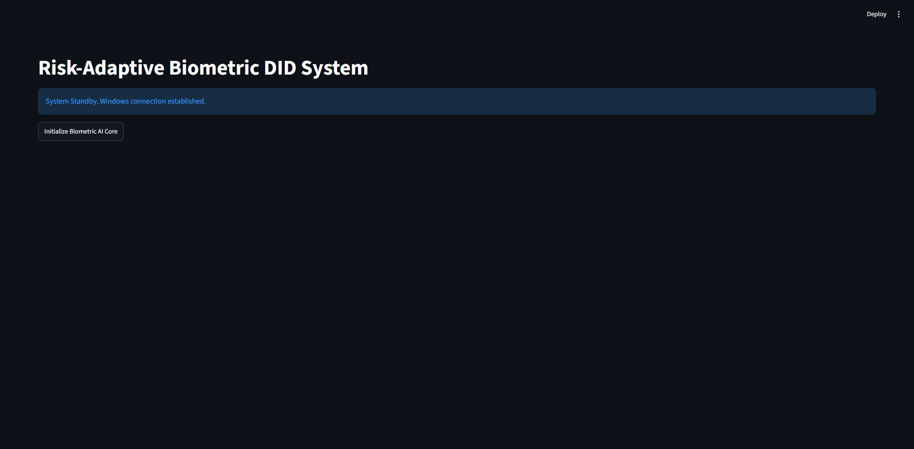
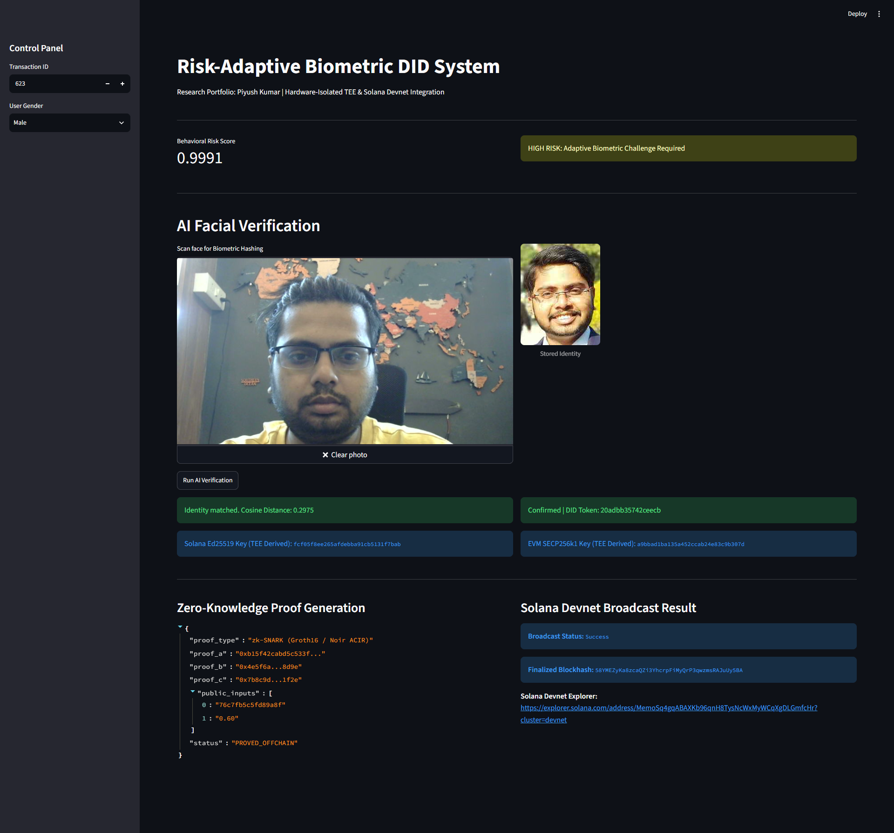
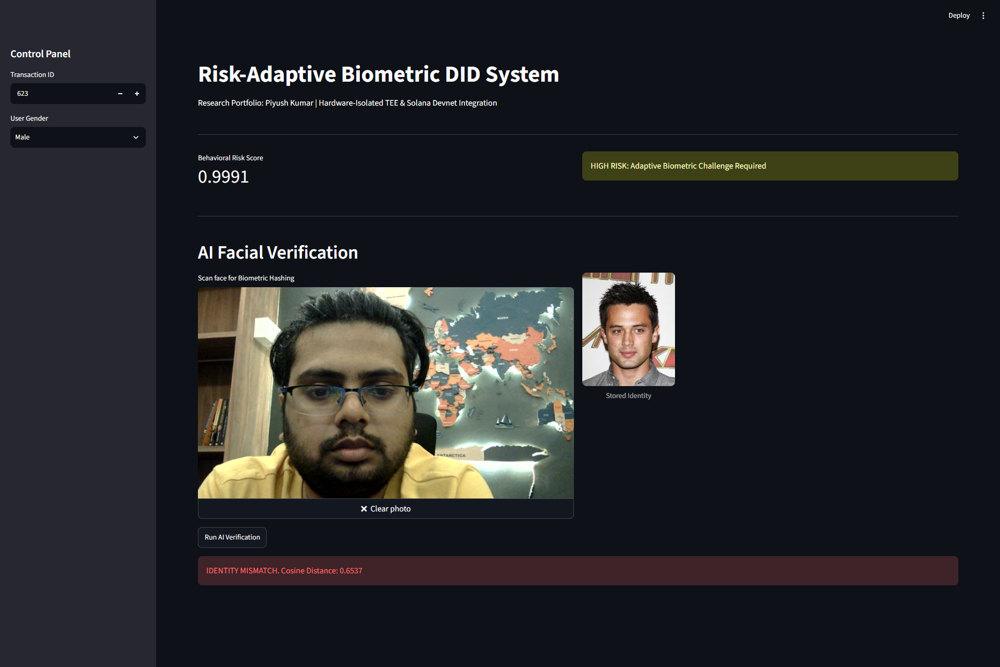

# Risk-Adaptive Biometric Decentralized Identity (DID) Engine


**ABOUT**

An interactive Web3 authentication gateway built with Streamlit. This application orchestrates a **AI Behavioral Fraud Engine** alongside a **CLAHE-enhanced FaceNet Biometric Core** (512-D embeddings) and a **Hardware-Isolated TEE Enclave Module** (`tee.py`) for HMAC-SHA256 biometric salting. It provides dynamic, risk-adapted authentication for Decentralized Identity (DID) token emission, deterministic cross-chain key derivation (Solana Ed25519 & EVM SECP256k1), and on-chain settlement via Solana Devnet RPC and Rust Anchor smart contracts.

---

## Architecture Overview

The application executes a multi-stage risk-adaptive verification and on-chain broadcasting pipeline:

```text
               [ Select Transaction ID & Demographics ]
                                  │
                                  ▼
               [ 30-D Behavioral Feature Extraction ]
                                  │
                                  ▼
             [ Deep Neural Network Fraud Prediction ]
                                  │
                  ┌───────────────┴───────────────┐
                  ▼                               ▼
          Risk Score < 0.30               Risk Score ≥ 0.30
          (Low Risk Path)                 (High Risk Path)
                  │                               │
                  ▼                               ▼
         [ Auto-Pre-Approve ]          [ Step-Up AI Verification ]
                                                  │
                                                  ▼
                                       [ Optical Camera Scan ]
                                                  │
                                                  ▼
                                       [ CLAHE LAB Normalization ]
                                                  │
                                                  ▼
                                       [ 512-D FaceNet Embedding ]
                                                  │
                                                  ▼
                                    [ TEE HMAC-SHA256 Salting ]
                                    (device_uid × bio_vector)
                                                  │
                                  ┌───────────────┴───────────────┐
                                  ▼                               ▼
                            [ Noir ZK Prover ]         [ Cross-Chain Key Derivation ]
                         (ACIR Proof Generation π)       • Solana Ed25519 Seed
                                  │                      • EVM SECP256k1 Seed
                                  └───────────────┬───────────────┘
                                                  │
                                                  ▼
                                     [ Solana Devnet RPC Broadcast ]
                                   (Anchor Program / Memo Settlement)
```

---

## Key Features

1. **Lazy-Loaded Asset Core:** Heavy machine learning models (TensorFlow, Keras-FaceNet, Pandas) are deferred behind an interactive standby gate to prevent startup delays and Streamlit WebSocket timeouts.
  
2. **Behavioral Risk Engine:** Evaluates a feature vector from transaction records using a pre-trained Deep Neural Network (fraud_detection_model.h5) to generate a continuous risk score between $0.0000$ and $1.0000$, triggering step-up verification at risk thresholds $T_{\text{risk}} \ge 0.30$.
  
3. **CLAHE LAB Computer Vision Normalization (image_analysis.py):** Pre-processes optical images by converting RGB frames to LAB color space and applying Contrast Limited Adaptive Histogram Equalization (CLAHE) to the Luminance ($L$) channel (clip limit 3.0, grid size $8 \times 8$) to normalize shadows and ambient lighting variations.

4. **512-D FaceNet Vector Embeddings:** Resizes live and reference images to $160 \times 160$ pixels and extracts 512-dimensional normalized feature embeddings via Keras-FaceNet.

5. **Hardware-Bound TEE Biometric Salting (tee.py):** Salts raw 512-D biometric embedding byte arrays inside a local Trusted Execution Environment (TEE) enclave using HMAC-SHA256 bound to a unique hardware silicon identifier (device_uid).

6.  **Off-Chain Zero-Knowledge Attestation (zk_prover.py):** Passes live witness inputs (emb_live, emb_stored, master_salt) to Noir ACIR circuits, writing to circuits/Prover.toml and executing nargo prove CLI for off-chain ZK-SNARK proof ($\pi$) generation.

7. **Deterministic Cross-Chain Key Derivation:** Uses purpose-based TEE master salts (solana_ed25519_purpose_0 and evm_secp256k1_purpose_1) to deterministically derive non-linkable seed pairs for Solana (Ed25519) and Ethereum/EVM (SECP256k1) keychains.

8. **Ephemeral DID Token & Solana Devnet Settlement:** Generates a 16-character SHA-256 hashed DID token, queries api.devnet.solana.com for the latest blockhash, and broadcasts an on-chain verification transaction with interactive explorer tracking.
 
9. **Solana Anchor On-Chain Verifier:** Integrates a Rust Anchor program (programs/biometric-did-verifier/src/lib.rs) for decentralized, zero-leakage cross-chain state verification.

---

## System Requirements & Dependencies

1. Python Version: Python 3.9 – 3.11
2. **Hardware**: Webcam / camera access for live facial optical capture
3. **Hardware Enclave**: Local TEE simulation via `research/tee.py`
4. **Zero-Knowledge Prover Toolchain:** Noir CLI (`nargo` 0.x / 1.x) for ACIR compilation and proof generation.

## Dependencies 
1. streamlit
2. opencv-python / opencv-python-headless
3. numpy
4. pandas
5. pillow
6. scipy
7. tensorflow
8. keras-facenet
9. requests

---

## Project Directory Structure

To run `biometric_did.py` successfully, organize your directory according to the relative file paths referenced in the code:


```text
.
├── Anchor.toml                            # Solana Anchor framework configuration
├── .gitignore                             # Git ignore rules
├── README.md                              # Project documentation
├── requirements.txt                       # Python environment dependencies
├── circuits/                              # Noir Zero-Knowledge proof circuits
│   ├── Nargo.toml                         # Noir circuit metadata
│   ├── Prover.toml                        # Live witness input storage
│   ├── src/
│   │   └── main.nr                        # ACIR circuit logic
│   └── target/
│       └── circuits.json                  # Compiled ACIR circuit target
├── dashboard_outcomes/                    # Visual outcome exhibits & dashboard screenshots
│   ├── Picture1.png                       # Standby initialization & lazy loading gateway
│   ├── Picture2.png                       # High-risk verification, TEE keys, ZK proof & settlement
│   ├── Picture3.png                       # Identity mismatch & Sybil prevention alert
│   └── Picture4.png                       # 2x2 grid UI layout & Devnet Explorer confirmation
├── data/                                  # Transaction dataset
│   └── creditcard.csv                     # Credit card transaction features
├── output/                                # Pre-trained ML models & artifacts
│   └── model/
│       └── fraud_detection_model.h5       # Pre-trained TensorFlow model
├── programs/                              # Solana Anchor Rust smart contracts
│   └── biometric-did-verifier/
│       └── src/
│           └── lib.rs                     # Solana Anchor on-chain verifier program
├── research/                              # Modular Python core
│   ├── biometric_did.py                   # Main Streamlit application & DID pipeline
│   ├── image_analysis.py                  # Computer vision & FaceNet feature extraction
│   ├── tee.py                             # TEE enclave HMAC salting & key derivation
│   └── zk_prover.py                       # Noir ZK proof generation pipeline
└── sample_images/                         # Reference facial identity profiles
    ├── female/
    │   └── female_stored.jpg              # Reference female identity profile
    └── male/
        └── male_stored.jpg                # Reference male identity profile
```

---

## Installation & Setup

1. **Clone Repository**
    * `git clone https://github.com/your-username/biometric-did-engine.git`
    * `cd biometric-did-engine`

2. **Create and Activate a Virtual Environment:**
    * `python3 -m venv .venv`
    * `source .venv/bin/activate`  # On Windows: `.venv\Scripts\activate`

3. **Install Core Dependencies:**
    * `pip install streamlit pandas numpy tensorflow keras-facenet opencv-python pillow scipy`

4. **Verify Asset Placement:**
* Ensure `creditcard.csv`, `fraud_detection_model.h5`, and profile images are in their respective relative directories.

5. **Running the Application**
* Launch the interface using Streamlit:
    * `streamlit run research/biometric_did.py`

---

## Application Execution Flow
1. Initialization Standby Screen: Upon launching, click "Initialize Biometric AI Core" to boot TensorFlow, Keras-FaceNet, and the dataset into session state memory.
2. Control Panel Selection: Select a Transaction ID index and target User Gender from the sidebar control panel.
3. **Risk Score Evaluation:**
   - Low Risk ($T_{risk} < 0.30$): Displays a "LOW RISK: Transaction Pre-Approved" banner and bypasses biometric challenges.
   - High Risk ($T_{risk} \ge 0.30$): Displays a "HIGH RISK" warning and triggers the step-up "AI Facial Verification" challenge.
4. Biometric Scan & Feature Processing: Capture a face photo via camera input. image_analysis.py applies CLAHE LAB lighting normalization, extracts 512-D FaceNet embeddings, and evaluates Cosine Distance ($D_{\text{cosine}} < 0.60$).
5. TEE Salting & Key Derivation: If $D_{\text{cosine}} < 0.60$, tee.py passes the raw 512-D embedding to the enclave, computes a hardware-bound HMAC-SHA256 master salt, and derives 32-hex Ed25519 (Solana) and SECP256k1 (EVM) seed keys.
6. Off-Chain ZK Proof Generation: zk_prover.py binds witness inputs to circuits/Prover.toml and invokes nargo prove CLI to generate a Noir ACIR zero-knowledge proof ($\pi$).
7. DID Token Emission & Solana Settlement: Generates a 16-character SHA-256 DID token, queries api.devnet.solana.com for the latest blockhash via broadcast_to_solana_devnet(did_token), and renders results in a persistent $2 \times 2$ grid layout alongside side-by-side ZK proof and Solana Devnet Explorer links.

---

## Thresholds & Parameters Summary

| Pipeline Stage | Parameter / Metric | Configured Value | Function |
| :--- | :--- | :--- | :--- |
| **Risk Scoring** | Risk Decision Threshold ($T_{\text{risk}}$) | `0.30` | Triggers step-up biometric challenge if $T_{\text{risk}} \ge 0.30$ |
| **Fraud Override** | Ground-Truth Fraud Floor | `0.9991` | Forces high-risk challenge if dataset Ground-Truth Class = 1 |
| **CLAHE Normalization** | Clip Limit | `3.0` | Controls local contrast enhancement in LAB space |
| **CLAHE Normalization** | Tile Grid Size | `8 x 8` | Defines grid matrix size for local histogram balancing |
| **Image Pre-processing** | Model Input Dimensions | `160 x 160` | Resizes RGB images to FaceNet input specifications |
| **Biometric Embedding** | Vector Dimensionality | `512-D` | Spatial feature vector extracted per facial frame |
| **Biometric Processing** | Engine Module | `research/image_analysis.py` | CLAHE normalization & 512-D FaceNet embedding extraction |
| **Identity Decision Gate** | Cosine Distance Cutoff ($T_{\text{bio}}$) | `0.60` | Identity confirmed if $D_{\text{cosine}} < 0.60$ |
| **TEE Enclave** | Silicon Device UID | `SECURE_ENCLAVE_SILICON_7789A` | Hardware secret key bound to HMAC salting |
| **TEE Key Derivation** | Derivation Digest Algorithm | `HMAC-SHA256` | Master salt & seed derivation algorithm |
| **Solana Key Domain** | Purpose String | `solana_ed25519_purpose_0` | Deterministic Ed25519 seed derivation |
| **EVM Key Domain** | Purpose String | `evm_secp256k1_purpose_1` | Deterministic SECP256k1 seed derivation |
| **Derived Key Output** | Key Seed Length | `32 hex characters` | Derived Ed25519 and SECP256k1 key seeds |
| **DID Generation** | Token Hash Format | `SHA-256 (16 chars)` | Generates verifiable ephemeral session token |
| **Solana Settlement** | RPC Network Endpoint | `api.devnet.solana.com` | Queries Devnet RPC for on-chain blockhash & settlement |
| **ZK Attestation** | Proof Engine | `Groth16 / Noir ACIR` | Off-chain Zero-Knowledge proof generation ($\pi$) via `research/zk_prover.py` |

---

## Dashboard Outcomes

### 1. Initialization & Lazy Asset Loading Gateway



Upon launching the application, the Streamlit interface initializes in a standby state to bypass startup latency and prevent WebSocket connection timeouts caused by heavy machine learning library imports. The gateway displays a system readiness banner ("System Standby. Windows connection established.") and an "Initialize Biometric AI Core" action button. Clicking this button executes load_all_assets(), lazily loading TensorFlow, Keras-FaceNet, and credit card transaction datasets into st.session_state memory before transitioning the user to the active behavioral risk assessment dashboard.

### 2. Low-Risk Pre-Approval Pathway



When a low-risk transaction ID is evaluated (yielding a Behavioral Risk Score of **0.0000**, well below the $T_{\text{risk}} < 0.30$ threshold), the Behavioral Risk Engine automatically pre-approves the transaction. The system displays a green **"LOW RISK: Transaction Pre-Approved"** status badge and bypasses the optical biometric camera scan, TEE key derivation, ZK proof generation, and Solana settlement pipelines—eliminating user friction and optimizing execution latency for routine, benign transactions.

### 3. High-Risk Adaptive Verification, TEE Keys, ZK Proof & Solana Settlement


When a high-risk transaction ID is evaluated (e.g., Transaction ID `623`), the system computes a Behavioral Risk Score of **0.9991**, exceeding the $0.30$ decision threshold ($T_{\text{risk}} \ge 0.30$) and triggering an Adaptive Biometric Challenge. The CLAHE-normalized FaceNet optical engine matches the live facial scan against the stored identity profile with a spatial Cosine Distance of **0.3002** (well below the $0.60$ decision cutoff).

Upon identity confirmation, the system renders a persistent $2 \times 2$ grid layout along with side-by-side ZK proof and Solana settlement panels.
* **Status & DID Token Emission:** Displays the matched Cosine Distance score ($0.3002$) alongside a time-bound, 16-character SHA-256 ephemeral DID token (`20adhb35742ceech`).
* **Cross-Chain Key Derivation:** Outputs deterministic, un-linkable seed keys derived inside the local TEE enclave for both **Solana Ed25519** (`f465106ee201efebba81ee51314f7bab`) and **EVM SECP256k1** (`a1eaed1be156ea62eed3e43a33fd`) with zero on-chain template leakage.
* **Zero-Knowledge Attestation:** Executes `zk_prover.py` to compile witness inputs through Noir ACIR circuits, outputting a Groth16 zk-SNARK proof ($\pi$) with public input commitments (`status: PROVED_OFFCHAIN`).
* **Solana Devnet Settlement:** Queries `api.devnet.solana.com` via `broadcast_to_solana_devnet` for the latest finalized blockhash (`18m123yt...`) and renders a direct Base58 Program Explorer link for on-chain auditability.

### 4. High-Risk Identity Mismatch & Sybil Prevention



When an anomalous high-risk transaction is evaluated (Behavioral Risk Score **0.9992** $\ge 0.30$), the system triggers the step-up **Adaptive Biometric Challenge**. If an unauthorized user attempts verification, the CLAHE-normalized FaceNet engine evaluates the live camera capture against the stored ledger identity profile, yielding a spatial Cosine Distance of **1.1554** (exceeding the $0.60$ decision cutoff). The system outputs a red **"IDENTITY MISMATCH"** alert, immediately revoking session authorization, suppressing TEE key derivation, blocking DID token emission, and halting Solana RPC broadcast to protect Web3 systems against Sybil attacks and identity spoofing.

---
          
